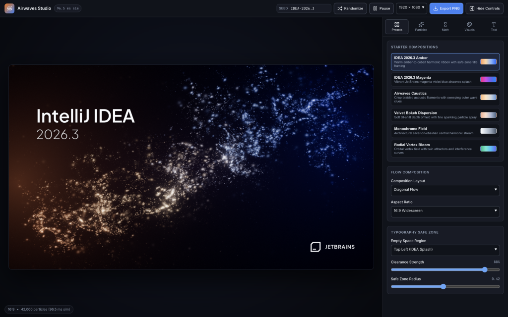
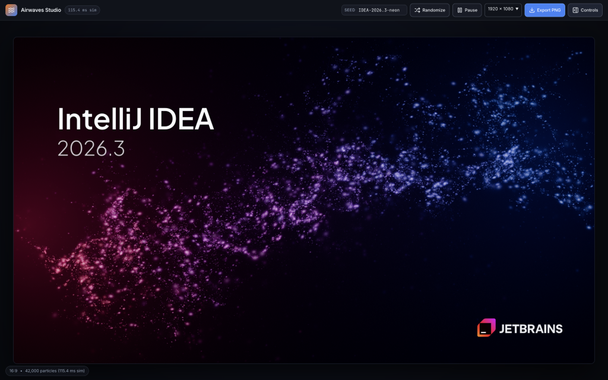
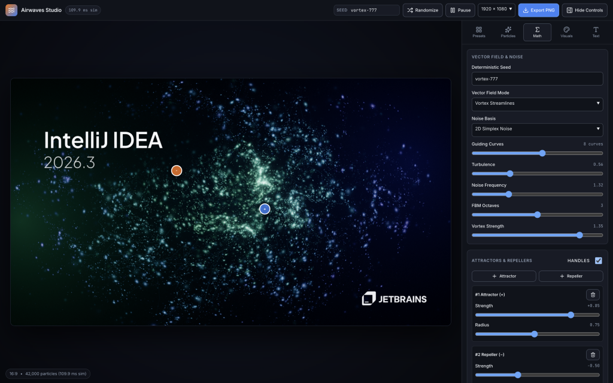

# Airwaves Studio

**Airwaves Studio** is an interactive, deterministic procedural particle-art generator for creating splash screen variations inspired by IntelliJ IDEA 2026.3 and acoustic airwave streams. Every composition is driven purely by mathematical algorithms—harmonic guiding curves, Simplex/Perlin curl noise, Runge-Kutta advection, and GPU optical bokeh shaders—with no AI APIs or raster textures.

## Previews

| Studio Interface (`IDEA 2026.3 Amber`) | Expanded Splash (`IDEA 2026.3 Magenta` + Gradient Logo) |
| :---: | :---: |
|  |  |

| Mathematical Field & Interactive Attractor / Repeller Handles (`Radial Vortex Bloom`) |
| :---: |
|  |

---

## Quick Start

```sh
npm install
npm run dev
```

Open the local URL printed by Vite (default `http://localhost:5173/`).

### Available Scripts

| Command | Description |
| :--- | :--- |
| `npm run dev` | Start the Vite development server with hot module reload |
| `npm test` | Run Vitest unit tests verifying deterministic simulation invariants |
| `npm run build` | Type-check (`tsc -b`) and build the production bundle into `dist/` |
| `npm run preview` | Preview the built production bundle locally |

---

## How to Use the Application

### Top Toolbar

- **Seed**: Enter any string (for example `IDEA-2026.3` or `vortex-777`) to reproduce an exact composition deterministically.
- **Randomize**: Generates a fresh seed, composition layout, vector field parameters, attractors, and color palette while preserving your typography settings.
- **Play / Pause**: Toggles gentle real-time GPU harmonic drift along the streamlines without altering the underlying seed.
- **Resolution & Export PNG**: Choose an export width (`1280px`, `1920px`, `2560px`, or `3840px`—automatically scaled to the active aspect ratio) and click **Export PNG** to render a high-resolution composite of the WebGL scene and vector typography/logo.
- **Hide Controls / Controls**: Collapse or expand the right-hand sidebar to inspect the artwork on a larger stage.

### Sidebar Controls

The collapsible sidebar groups controls into five tabs:

1. **Presets**:
   - Load curated starter compositions (`IDEA 2026.3 Amber`, `IDEA 2026.3 Magenta`, `Airwaves Caustics`, `Velvet Bokeh Dispersion`, `Monochrome Field`, `Radial Vortex Bloom`).
   - Switch **Composition Layout** (`Diagonal Flow`, `Central Wave`, `Horizontal Flow`, `Vertical Flow`, `Radial Flow`), **Aspect Ratio** (`16:9`, `16:10`, `4:3`, `1:1`, `21:9`, `9:16`), and the **Typography Safe Zone** (clears and deflects particles around the title region).
2. **Particles**:
   - Adjust **Particle Count** (`5k–100k`), **Ridge Density**, **Size Distribution** (`Bimodal Sparks + Bokeh`, `Power-Law Heavy Tail`, `Fine Caustic Dust`, `Uniform Pearls`), **Size Variance**, **Flow Direction / Angle**, **Wave Curvature**, **Dispersion Spread**, and **Trail Length**.
3. **Math**:
   - Configure the deterministic **Seed**, **Vector Field Mode** (`Harmonic Airwave Ribbon`, `Incompressible Curl Field`, `Vortex Streamlines`, `Wave Interference`), **Noise Basis** (`2D Simplex Noise` or `2D Perlin Gradient Noise`), **Guiding Curves** (`1–14`), **Turbulence**, **Noise Frequency**, **FBM Octaves**, and **Vortex Strength**.
   - Add **Attractors (`+`)** and **Repellers (`−`)**, tune their strength and radius, and toggle **Handles** to drag them directly on the canvas.
4. **Visuals** *(GPU-instant — no simulation recalculation)*:
   - Choose a built-in **Color Palette** or customize all 4 gradient stops and the **Background Color**.
   - Adjust **Ambient Edge Glow**, **Bloom Intensity & Threshold**, **Depth of Field (Bokeh)**, **Focal Plane Depth**, **Particle Scale**, **Particle Brightness**, **Transparency**, **Trail Fade Opacity**, and **Airwave Curve Clues** visibility.
5. **Text**:
   - Toggle and edit **Primary Title** (`IntelliJ IDEA`) and **Version / Subtitle** (`2026.3`), typeface (`Plus Jakarta Sans`, `Inter`, `JetBrains Mono`), anchor corner, fine X/Y offsets, scale, and color.
   - Toggle the official **JetBrains Branding** overlay, switching between **Official Monochrome** and **Official Brand Gradient** styles as well as `Mark + JETBRAINS`, `Cube Mark Only`, and `Wordmark Only` variants.

---

## How It Is Implemented

Airwaves Studio is built with **React**, **TypeScript**, **Three.js**, and custom **GLSL** shaders.

A core architectural principle is the **strict separation of mathematical simulation from GPU rendering**:

1. **Mathematical Simulation (`SimParams` → `SimulationData`)**:
   - `runSimulation()` initializes a deterministic `Mulberry32` PRNG and seeded `Noise2D` instance from `sim.seed`.
   - It constructs harmonic guiding curves, warps points through 2D Simplex/Perlin curl noise and attractor/repeller potentials, runs 2nd-order Runge-Kutta (RK2) advection, emits streamline trails, and applies the typography safe-zone mask.
   - All particle positions, depths, velocities, and curve/trail vertices are stored in typed `Float32Array` buffers and memoized exclusively on `config.sim`.
2. **GPU Rendering (`VisualParams` → GLSL Uniforms & Post-Processing)**:
   - `SplashRenderer` uploads `SimulationData` to an `InstancedBufferGeometry` quad mesh (avoiding WebGL `gl_PointSize` limits during 4K export), `LineSegments` for guiding airwave clues and trails, and a `HalfFloatType` `EffectComposer` with `UnrealBloomPass` and ACES filmic tone mapping.
   - Editing colors, bloom, or Depth of Field updates only shader uniforms at 60 fps without re-running the particle simulation.
3. **Vector Overlay & High-Res PNG Export (`TypographyParams` → Canvas 2D)**:
   - `drawTypographyAndLogo()` renders typography and the official JetBrains `Path2D` vector mark onto a high-DPI overlay canvas synchronized with the preview, and re-runs identically on an offscreen composite canvas during high-resolution PNG export.

### Deep Technical Documentation

- [System Architecture & Data Flow](docs/architecture.md) — module breakdown, simulation/rendering separation, and high-resolution export pipeline.
- [Mathematical & Simulation Model](docs/mathematics.md) — deterministic PRNG seeding, Simplex/Perlin curl fields, harmonic caustic curves, RK2 advection, and safe-zone masking.
- [WebGL Shaders, Optics & Vector Compositing](docs/rendering.md) — instanced-quad bokeh DoF, energy conservation, HDR bloom, tone mapping, and official JetBrains `Path2D` rendering.
